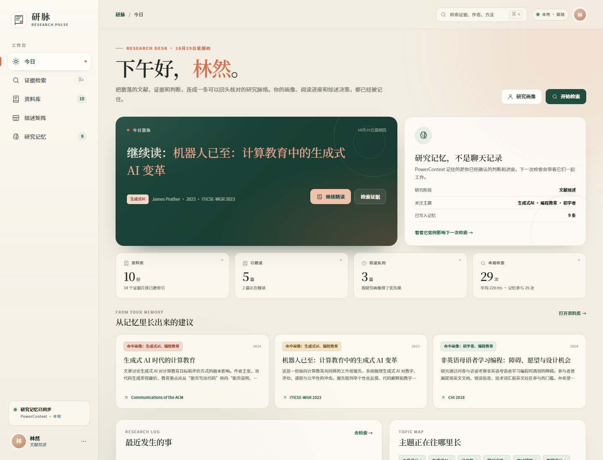
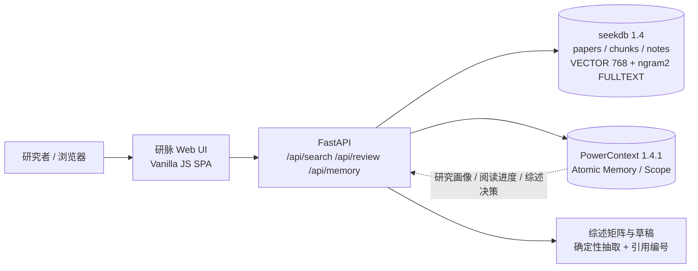

# 研脉 ResearchPulse

> 把散落的文献、证据和研究判断，连成一条可以回头核对的综述路径。

研脉是面向研究生和科研初学者的**可追溯文献综述工作台**。它不替用户“编”综述，而是把
资料库、混合检索、原文证据、综述矩阵、写作草稿和研究记忆串成一条完整链路：

- 用 **seekdb** 保存论文/笔记、证据片段与 768 维向量，在同一查询里做**向量召回 + ngram 全文召回**；
- 用 **PowerContext** 保存研究画像、阅读进度、检索决策和综述选择，下一次检索/写作时重新读取；
- 用 **Qoder / Qoder Sites** 完成开发与项目网站发布（见 [Qoder 交接说明](docs/QODER_HANDOFF.md)）。



## 1. 它解决什么问题

| 真实痛点 | 研脉的处理方式 |
| --- | --- |
| 读了 20 篇论文，写综述时找不到“那句话在哪一页” | 每篇资料切成带章节/页码的证据片段，检索结果直接展示原文和出处 |
| 关键词搜不到、语义搜又容易“编” | 向量召回负责“意思相近”，ngram 全文召回负责“原话对得上”，融合后保留 SQL 轨迹 |
| 综述矩阵每次从零做，读完就忘 | 研究问题/设计/样本/发现/局限/可复用点结构化保存，一键生成 6 列矩阵 |
| 每次打开 AI 都要重新讲一遍研究方向 | PowerContext 保存画像、阅读进度、综述选择，下次检索自动参与排序 |
| 写作时不知道哪句话有证据 | 草稿使用 `[1]` 引用编号，文末自动生成参考文献；每个编号可回到资料库 |

演示画像：教育技术学研二，正在做「生成式 AI 辅助编程学习」开题综述。内置 10 份资料
（9 篇论文 + 1 份组会笔记）、34 个证据片段。

## 2. 功能地图

| 页面 | 能做什么 |
| --- | --- |
| 今日 | 问候、今日聚焦、继续阅读、按记忆排序的推荐、研究活动与主题分布 |
| 证据检索 | 自然语言检索；状态/年份/类型/主题筛选；相关性分数、命中理由、原文片段、SQL 轨迹 |
| 资料库 | 10 份资料的状态、标签、综述字段覆盖度；多选后一键进入矩阵 |
| 综述矩阵 | 6 维对比表；覆盖率与缺失提示；单元格可直接编辑；生成带引用的综述草稿 |
| 研究记忆 | 画像编辑、Atomic Memory 时间线、召回测试、写入研究判断、Scope/Revision 证据 |
| 精读抽屉 | 中文导读、证据片段、精读笔记、综述字段、单篇 BibTeX 导出；状态变化自动写入 PowerContext |

## 3. 技术架构



- **seekdb** 是唯一的事实来源：资料、片段、向量、全文索引、检索日志都在这里。查询结果附 SQL 轨迹。
- **PowerContext** 是跨会话的状态层：保存“你是谁、在读什么、为什么这样选”，不保存伪造的证据。
- **融合分数**：`0.44 × 语义相似度 + 0.31 × 全文相关度 + 0.15 × 主题重合 + 0.10 × 阅读状态`。
  记忆只影响后两项，不改变原文片段。

## 4. 快速运行

完整步骤（含 seekdb / PowerContext 安装）见 [`docs/RUNBOOK.md`](docs/RUNBOOK.md)。

```powershell
# 1. 本项目目录
cd qoder

# 2. Python 3.10–3.12（推荐 3.12）
python -m venv .venv
.\.venv\Scripts\python.exe -m pip install -r requirements.txt

# 3. 启动 seekdb（示例路径按本机修改）
#    seekdb 监听 127.0.0.1:2881，root / 空密码
# 4. 启动 PowerContext（监听 127.0.0.1:8765）
# 5. 导入 10 份演示资料 + 研究记忆
Copy-Item .env.example .env
.\.venv\Scripts\python.exe scripts\init_db.py --reset

# 6. 启动
.\.venv\Scripts\python.exe -m uvicorn app.main:app --host 127.0.0.1 --port 7860
```

打开 <http://127.0.0.1:7860>。如果暂时没有 PowerContext，页面仍可检索（会显示“记忆降级”），
但画像/进度/矩阵记忆不会写入。

## 5. 验证样例（最短路径）

1. 打开「证据检索」，输入：`AI 编程助手对初学者学习迁移的影响`。
2. 预期：至少 6 篇结果；顶部包含 `组会纪要：AI 编程助手研究设计讨论`、
   `AI 代码生成器如何支持编程入门学习者`、`没有护栏的生成式 AI 可能损害学习`；
   右侧显示“研究记忆参与排序”。
3. 点「查看 SQL 轨迹」：能看到 `cosine_distance` 向量召回与 `MATCH ... AGAINST` 全文召回两条 SQL。
4. 打开任一结果 →「证据片段」，能看到章节/页码与原文。
5. 进入「综述矩阵」，选 4 篇，生成矩阵；预期 4 行 × 6 列、覆盖率 100%、草稿 4 条引用。
6. 进入「研究记忆」，在「召回一条记忆」输入 `学习迁移`，应召回画像/阅读进度；
   写一条研究判断后，时间线出现新的 `research_note`。

自动验收：

```powershell
.\.venv\Scripts\python.exe scripts\acceptance.py
# PASS: 23 checks -> docs/evidence/acceptance.json
```

详细输入、预期与证据文件见 [`docs/VALIDATION.md`](docs/VALIDATION.md)。

## 6. 目录

```
qoder/
├── app/                 # FastAPI、seekdb schema、混合检索、PowerContext 客户端、综述生成
├── web/                 # 无构建步骤的中文 SPA（HTML/CSS/ES Module）
├── seed/                # 10 份演示资料与研究画像
├── scripts/             # 初始化、验收、浏览器截图/录屏
├── docs/                # 运行说明、验证样例、技术证据、Qoder 开发记录
├── site/                # Qoder Sites 用的静态项目网站
├── tests/               # 接口与检索测试
├── requirements.txt
└── .env.example
```

## 7. 指定技术的实际作用

### seekdb

- `papers`、`chunks`、`notes` 保存资料与证据；`chunks.embedding VECTOR(768)` +
  `VECTOR INDEX ... HNSW`；`FULLTEXT INDEX ... WITH PARSER ngram2` 支持中文全文；
  精读抽屉的 `GET /api/papers/{paper_id}/bibtex` 会从 `papers` 元数据生成 BibTeX。
- 一次检索实际执行两条 SQL：向量 Top-60 召回、全文 Top-30 召回；应用层融合并按论文聚合。
- `search_log` 保存查询、筛选、耗时、结果数与记忆是否参与，用于真实使用统计。

### PowerContext

- Scope：`研脉 · 研究上下文`（`/v1/scopes`）。
- Atomic Memory kind：`research_profile`、`reading_progress`、`review_board`、`research_note`、`search_decision`。
- 写入：`POST /v1/memory/remember`；读取：`POST /v1/memory/entries/list`；
  召回：`POST /v1/memory/search`（`mode=fts`）。
- 实际复用：画像主题给检索结果加权；阅读进度生成「继续阅读」；综述选择在下次打开矩阵时恢复。

证据：[`docs/TECH_USAGE.md`](docs/TECH_USAGE.md)、[`docs/evidence/`](docs/evidence/)。

## 8. Qoder 开发与 Qoder Sites

本仓库已按赛题要求放入 `qoder/` 目录，并提供：

- [`docs/QODER_DEVLOG.md`](docs/QODER_DEVLOG.md)：开发阶段、关键决策、调试记录；
- [`docs/QODER_HANDOFF.md`](docs/QODER_HANDOFF.md)：在 Qoder 中导入、重放、截图、发布 Sites 的逐步清单；
- [`site/`](site/)：已完成的静态项目网站，可直接作为 Qoder Sites 的发布内容。

> **提交前必须完成**：在 Qoder 中登录个人账号，按交接清单重放关键开发环节并截图/录屏，
> 记录 Qoder 账号 UID；通过 Qoder Sites 发布 `site/` 并设为「任何人都可访问」。
> 仓库内不放置任何真实 API Key、密码或访问令牌。

## 9. 数据与引用说明

- 演示语料的中文导读是**项目改写的检索用摘要**，不是原文翻译；DOI/链接尽量指向原始来源。
- `组会纪要：AI 编程助手研究设计讨论` 是**内置演示笔记**，不是真实课题组资料。
- 综述草稿是确定性抽取的写作骨架，不能替代阅读原文；所有引用编号都应回查。
- 本项目未使用任何真实用户个人信息；使用效果数据来自开发自测，不冒充外部用户反馈。

## 10. 版本

- Python 3.12（兼容 3.10+）
- seekdb 1.4.0.0（Windows 原生，MySQL 协议 2881）
- PowerContext 1.4.1（SQLite 后端，HTTP 8765）
- FastAPI 0.162 / Uvicorn 0.54 / PyMySQL 1.2
- 前端无框架、无构建步骤
