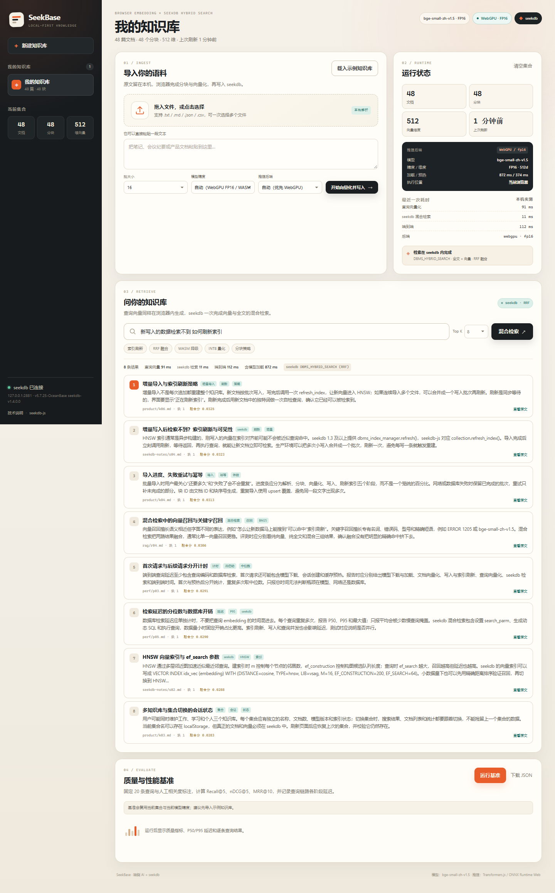

# SeekBase · 端侧知识库

> 浏览器本地向量化 + seekdb 向量/全文混合检索。  
> 2026 生态赛 · 阶跃星辰方向 · `stepfun/`



SeekBase 是一个可以直接在浏览器里导入文档、生成 embedding、写入 seekdb 并做混合检索的迷你知识库。文档和查询的向量都在当前设备计算；seekdb 负责持久化与数据库内的 RRF 融合排序；前端只展示数据库返回的结果。

## 功能

- **浏览器端 embedding**：Transformers.js + ONNX Runtime Web，模型文件从同源静态目录加载，无云端推理。
- **两档量化**：INT8（`q8`，22.90 MiB，3.95× 压缩）与 FP16（45.30 MiB，2.00× 压缩）；可按集合选择，支持 FP32 基线。
- **WebGPU 优先**：有 `navigator.gpu` 且能拿到 adapter 时使用 WebGPU + FP16；否则自动降级 WASM + INT8，并在界面显示后端和降级原因。
- **seekdb 混合检索**：`DBMS_HYBRID_SEARCH` 在数据库内完成全文 query_string、向量 KNN 和 RRF；不是客户端拼两路结果。
- **增量导入**：`docId#chunkIndex` 稳定块 ID + `upsert`；一次导入只刷新一次索引，刷新后自检新文档可检索。
- **多集合/会话**：创建、切换、清空、删除集合；localStorage 记住当前集合、后端、精度和批大小。
- **可复现基准**：内置 20 条中文查询，计算 Recall@5 / nDCG@5 / MRR@10，并记录加载、向量化、写入、刷新、查询和端到端延迟。
- **中文语料**：48 篇示例文档，覆盖 seekdb、端侧推理、RAG、中文处理、性能与产品六个主题。

## 架构

```
┌──────────────────────────── Browser (user device) ────────────────────────────┐
│  file / paste → chunk → tokenizer → ONNX Runtime Web (WebGPU FP16 / WASM INT8) │
│                                      │                                        │
│                                      ├─ document vectors ──┐                  │
│                                      └─ query vector ──────┼──┐               │
└─────────────────────────────────────────────────────────────┼──┼───────────────┘
                                                              │  │ HTTP (same origin)
┌──────────────────────── Node / Express (local machine) ─────▼──▼───────────────┐
│  /api/import  → seekdb-js upsert → refresh_index()                            │
│  /api/search  → seekdb-js hybridSearch → DBMS_HYBRID_SEARCH (RRF)             │
│  kb_collections / kb_documents (state)                                        │
└──────────────────────────────────────┬─────────────────────────────────────────┘
                                       │
                              seekdb 1.4 (server/embedded)
```

- 浏览器只发向量、原文和元数据到本机服务；不访问任何云端 embedding API。
- `/api/search` 只有一次 `collection.hybridSearch(...)` 调用；前端不重新排序。
- Windows 使用 seekdb server 模式（embedded 在 Windows 尚未支持）；Linux/macOS 可用嵌入式模式。

## 快速开始

### 环境

- Node.js **20+**（实测 24.15）
- Chrome / Edge 最新版（实测 Edge 156.0.4314.50）
- seekdb **1.4.0**（Windows x64 使用 server 模式）

### 1. 安装依赖

```bash
cd stepfun
npm install
```

仓库已带 `INT8 + FP16` 模型文件（约 68.7 MiB）。如果文件缺失，执行：

```bash
npm run fetch-model          # INT8 + FP16
npm run fetch-model -- --all # 再加 FP32 基线（约 +90.5 MiB）
npm run fetch-model -- --check
```

模型来源固定为 `Xenova/bge-small-zh-v1.5` revision `75c43b069aac4d136ba6bc1122f995fedcfd2781`，文件哈希见 [`web/models/manifest.json`](web/models/manifest.json)。

### 2. 启动 seekdb

**Windows**

1. 从 <https://github.com/oceanbase/seekdb/releases> 下载 seekdb 1.4 win64，解压到 `vendor/seekdb/`（或设置环境变量 `SEEKDB_EXE`）。
2. 启动：

```powershell
powershell -ExecutionPolicy Bypass -File .\scripts\start-seekdb.ps1
```

脚本会在 `127.0.0.1:2881` 启动本地 server。首次 bootstrap 可能需要 1–2 分钟。若 2881 已有 seekdb，脚本会直接复用。

**Linux / macOS**

可以用本地 server：

```bash
./seekdb --base-dir=./runtime/seekdb-server --port=2881
```

或使用嵌入式模式：

```bash
export SEEKDB_MODE=embedded
export SEEKDB_PATH=./runtime/seekdb-embedded
```

### 3. 启动应用

```bash
npm start
```

打开 <http://127.0.0.1:5173>。应用会自动创建 `stepfun_kb` 数据库和 `default` 集合。

可选配置：

```bash
cp .env.example .env
# 修改 PORT / SEEKDB_PORT / SEEKDB_DATABASE 等
```

### 4. 演示流程

1. 点击 **载入示例知识库**：48 篇文档在浏览器内分块、向量化并写入 seekdb，约 2–4 秒（取决于后端）。
2. 在搜索框输入“新写入的数据检索不到 如何刷新索引”，查看 seekdb 返回的 8 条融合结果；点击“查看原文”展开完整块。
3. 点击 **运行基准**：固定 20 条查询，显示 Recall@5、nDCG@5、MRR@10 和 P50/P95 延迟，可下载 JSON。
4. 在左栏新建/切换集合，验证每个集合独立的文档、向量和会话状态。

## 目录

```
stepfun/
├─ server/                  Express API + seekdb-js 数据层
│  ├─ index.js              HTTP / 静态资源
│  ├─ db.js                 集合、upsert、refresh_index、hybridSearch
│  └─ config.js             环境变量与模型/索引配置
├─ web/
│  ├─ index.html / styles.css / app.js
│  ├─ lib/embedder.js       Transformers.js、WebGPU/WASM、批处理
│  ├─ lib/chunk.js          中文分块、稳定 ID、文件解析
│  ├─ lib/metrics.js        Recall/nDCG/MRR、统计
│  ├─ seed/corpus.json      48 篇示例语料
│  ├─ seed/eval.json        20 条查询 + 人工相关度
│  └─ models/               ONNX 模型 + manifest
├─ scripts/
│  ├─ start-seekdb.ps1      Windows seekdb server 启动
│  ├─ fetch-model.mjs       模型下载/校验
│  ├─ acceptance.mjs        功能验收（Playwright）
│  ├─ fallback-test.mjs     WebGPU 不可用 → WASM 验收
│  ├─ bench-collections.mjs 四种精度/后端组合的质量+性能
│  ├─ optimization-bench.mjs 批大小与刷新策略对比
│  └─ network-audit.mjs     外部请求审计
├─ docs/                    技术说明、基准、测试日志、截图、原始 JSON
└─ tests/                   纯函数单元测试
```

## seekdb 结构

应用启动时自动创建：

- `kb_collections`：集合显示名、模型、维度、精度、文档数、块数、最近导入/刷新时间。
- `kb_documents`：`collection_name + doc_id` 主键，标题、来源、tags、块数。
- seekdb-js 生成的集合表：`id VARBINARY(512)`、`document STRING`、`embedding VECTOR(512)`、`metadata JSON`、`FULLTEXT INDEX ... ngram2`、`VECTOR INDEX ... HNSW`。

索引参数：`M=16, EF_CONSTRUCTION=200, EF_SEARCH=64, cosine`；全文 `ngram2, min=2, max=2`；融合 RRF `rankWindowSize=40, rankConstant=60`。

## 实测摘要

同一设备、48 篇/48 块、20 条查询、3 次独立建库中位数，详见 [`docs/benchmark.md`](docs/benchmark.md) 和 [`docs/results/`](docs/results/)：

| 配置 | 模型体积 | 文档向量化 48 块 | seekdb 检索 P50 | 端到端 P50 | R@5 | nDCG@5 |
|---|---:|---:|---:|---:|---:|---:|
| INT8 + WASM | 22.90 MiB (3.95×) | 1288 ms | 9.8 ms | 27.4 ms | 0.733 | 0.861 |
| FP16 + WebGPU | 45.30 MiB (2.00×) | 236 ms | 7.3 ms | 25.5 ms | 0.750 | 0.866 |
| FP32 + WASM（基线） | 90.46 MiB (1.00×) | 2072 ms | 7.1 ms | 26.0 ms | 0.750 | 0.866 |
| FP32 + WebGPU（基线） | 90.46 MiB (1.00×) | 299 ms | 6.8 ms | 24.9 ms | 0.750 | 0.866 |

- 批大小 1 → 16：48 块向量化 352.9 ms → 84.2 ms（**4.19×**）。
- 每 8 块刷新 → 整批刷新一次：3395 ms → 837 ms（**4.06×**）。
- WebGPU FP16 vs WASM INT8：文档向量化 1288 ms → 236 ms（**5.45×**）；首次加载/预热多约 0.3 s。
- 首次打开到首条结果约 **1.2–1.5 s**（本地模型）；预热后查询端到端 P50 约 **25–27 ms**。

## 复现测试

```bash
npm test                         # 纯函数单元测试（5 项）
node scripts/acceptance.mjs      # 创建/增量/刷新/切换/删除，10 项
node scripts/fallback-test.mjs   # --disable-gpu 模拟 WebGPU 不可用
node scripts/network-audit.mjs   # 应只出现 127.0.0.1 请求
node scripts/bench-collections.mjs
node scripts/optimization-bench.mjs
```

浏览器脚本使用 `playwright-core`，默认调用 Windows Edge；其他平台设置 `EDGE_PATH` 指向 Chromium/Edge 可执行文件。基准脚本会在 `runtime/results/` 写 JSON，并在 `runtime/screens/` 写截图。

## 合规边界

- **不调用云端推理 API**；模型文件同源加载，推理在用户设备执行。
- **不预计算/回放**服务端向量；`/api/import` 只接收浏览器生成的向量。
- **存储/检索全部走 seekdb**；没有用 IndexedDB 或内存数组替代向量检索。
- 前端只渲染 `/api/search` 返回的数据库排序结果；没有客户端 RRF/二次排序。
- 原文会发送到本机 Node/seekdb 以便持久化与全文检索；若需要“原文也不出端”，请将 Node/seekdb 也部署在用户本机（本项目默认即本机部署）。

## 提交信息

- 项目目录：`stepfun/`
- 分支：`2026-competition-ecosystem` 与 `submission-2026` 均指向同一提交
- 提交 commit：以远端分支最新 HEAD 为准（`git -C stepfun rev-parse HEAD`）
- 技术说明：[`docs/technical-note.md`](docs/technical-note.md)
- 测试日志：[`docs/test-log.md`](docs/test-log.md)
- 复现步骤：[`docs/reproduction.md`](docs/reproduction.md)
- 原始基准 JSON：[`docs/results/`](docs/results/)
- 第三方许可证：[`THIRD_PARTY_NOTICES.md`](THIRD_PARTY_NOTICES.md)
